# PagedAttention：Efficient Memory Management for Large Language Model Serving with PagedAttention

> **发表信息**：SOSP 2023，2023 年 10 月 23–26 日，德国 Koblenz。
> **作者**：Woosuk Kwon（UC Berkeley，共同一作）、Zhuohan Li（UC Berkeley，共同一作）、Siyuan Zhuang、Ying Sheng、Lianmin Zheng、Cody Hao Yu、Joseph E. Gonzalez、Hao Zhang、Ion Stoica。
> **机构**：UC Berkeley、Stanford University、独立研究者、UC San Diego。
> **论文 DOI**：[10.1145/3600006.3613165](https://doi.org/10.1145/3600006.3613165)。
> **代码**：[vllm-project/vllm](https://github.com/vllm-project/vllm)。
> **阅读版本**：用户提供的 16 页 PDF，首页标记 arXiv:2309.06180v1。下文页码均指该 PDF 页码，与页脚一致。
> **范围**：解释这篇 2023 年论文中的设计与实验，不把后续 vLLM 版本的新增功能混入原文。

**一句话概括**：PagedAttention 让逻辑连续的 KV Cache 可以存放在不连续的物理块中，再通过按需分配、共享和写时复制减少显存浪费，使同一 GPU 能同时处理更多请求。

阅读时抓住这条主线：**KV 太占空间 → 连续预分配又浪费空间 → 能同时运行的请求少 → 用分页解除存储约束 → 扩大有效批次 → 提高服务容量。**

## 一、研究背景与动机

### 1.1 真正限制批处理的，是能够驻留显存的请求状态

LLM 在线推理不仅要装下模型权重，还要保存每个正在生成的请求的历史状态。权重由多个请求共用，而 KV Cache 随请求数和序列长度增长。

论文以 A100 40GB 上的 13B 模型为例，权重约占 65% 显存，KV Cache 占用接近 30%，其他空间用于临时激活等数据（原文 Fig. 1，p.1）。因此，不能把整个 GPU 显存都看作可分配给请求的空间。

批处理能让多个请求共同摊薄读取模型权重的成本，提高 GPU 计算利用率。但如果 KV Cache 已经占满剩余显存，就无法继续增大批次。**这篇论文关注的是显存容量和分配效率对并发的限制。**

这里应区分两个“内存瓶颈”：Decode 的算术强度低，常受内存带宽制约；KV Cache 太大、分配不合理，则会受显存容量制约。PagedAttention 直接改善后者，再通过更大的批次间接改善硬件利用率。

### 1.2 FasterTransformer 和 Orca 为什么仍会浪费显存

原文将 FasterTransformer [31] 和 Orca [60] 作为主要对照。前者擅长优化推理算子，后者采用迭代级调度，但本文讨论的连续 KV 存储方式仍需要为请求预留空间（原文 §1、§3.1，pp.2–4）。

这三类浪费必须分清：

| 浪费类型 | 含义 | 为什么影响并发 |
| --- | --- | --- |
| Reservation，提前保留 | 以后可能实际用到，但当前还没生成对应 token | 在真正需要之前，别的请求不能使用这部分空间 |
| Internal fragmentation，内部碎片 | 分配给请求、但最终没有用到的槽位 | 请求比预留长度短，剩余空间一直闲置 |
| External fragmentation，外部碎片 | 分配器中的空间碎片，难以满足所需连续分配 | 总空闲空间尚可，但无法组成合适的连续区域 |

即使能预知最终输出长度，也只解决了部分过度分配：**未来才用到的槽位仍被提前占住，连续分配造成的碎片也仍可能存在。** 这解释了为什么论文中的 Orca (Oracle) 也不是无浪费的基线。

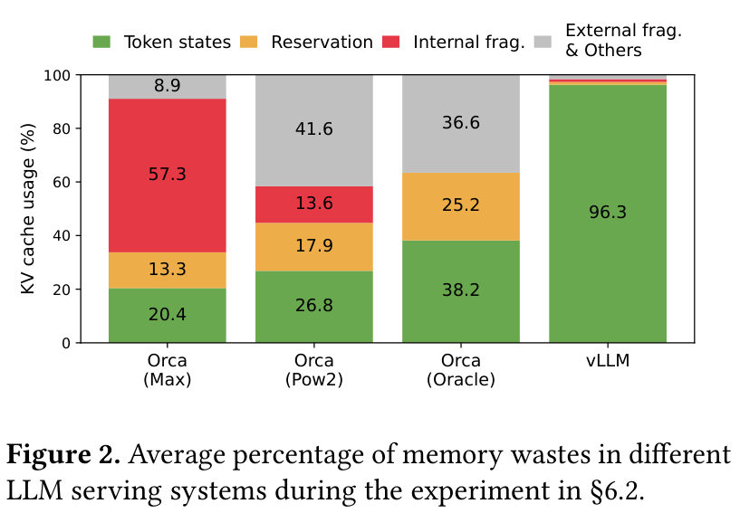

**上图解释**：横轴是不同系统，纵轴是 KV Cache 空间的平均占用构成，绿色才是实际 token 状态。Orca 三种配置的绿色比例分别为 20.4%、26.8%、38.2%，vLLM 为 96.3%。这张图支持的是“分配效率提高”，并非 GPU 总显存使用率或计算利用率达到同样数值（原文 Fig. 2，p.2）。

还有一类冗余来自多输出场景。同一个 prompt 生成多个回答时，前缀的 KV 本可共用；如果每条输出都保存完整副本，就进一步压低并发能力。

### 1.3 核心洞察：逻辑连续，不要求物理连续

注意力需要按正确的位置读取历史 K、V，但并不要求整条序列的 KV 在显存地址上紧挨着。只要能找到对应数据，并正确计算全局注意力，就可以改变存储方式。

作者借鉴操作系统分页，将“整条序列一大块”改为“多个固定大小的小块”，通过映射表连接逻辑顺序与物理位置。分页、缓存共享和写时复制由此可以统一起来。

## 二、预备知识与形式化定义

### 2.1 自回归生成为什么需要保存历史状态

原文 Eq. 1 将序列概率分解为条件概率的乘积（p.3）：

$$
P(x)=P(x_1)\cdot P(x_2\mid x_1)\cdots P(x_n\mid x_1,\ldots,x_{n-1}). \tag{1}
$$

这里 $x_i$ 是第 $i$ 个 token。输入 prompt 已知，但后面的输出还未生成，所以需要逐 token 采样。后一个 token 的生成依赖前面的结果。

原文 Eq. 2 描述注意力层的投影：

$$
q_i=W_qx_i,\qquad k_i=W_kx_i,\qquad v_i=W_vx_i. \tag{2}
$$

这里原文复用 $x_i$ 表示该层输入的隐藏状态，而不是直接把 token ID 乘以矩阵。$W_q,W_k,W_v$ 是训练得到的参数，本论文不会通过新的训练目标改变它们。

原文 Eq. 3 给出因果注意力：

$$
a_{ij}=\frac{\exp(q_i^\top k_j/\sqrt d)}{\sum_{t=1}^{i}\exp(q_i^\top k_t/\sqrt d)},\qquad
o_i=\sum_{j=1}^{i}a_{ij}v_j. \tag{3}
$$

$q_i$ 表示当前位置的查询，$k_j,v_j$ 是位置 $j$ 的键和值，$d$ 是注意力向量维度，$a_{ij}$ 是位置 $j$ 对当前位置的权重，$o_i$ 是输出。分母覆盖当前因果范围内的所有位置，不能仅在某个局部块内归一化。

**KV Cache 的作用**是保存此前各层已经算好的 K、V。Decode 时仍要计算新输入 token 的隐藏状态和 Q、K、V，再读取历史缓存做注意力；它省掉的是反复计算历史 K、V，而不是省掉所有历史注意力计算。

由于隐藏状态包含前文信息，位置编码也会影响计算，**不能看到两个相同的词就直接共享 KV**。安全共享需要相同的有效前缀和兼容的模型、位置等计算条件。

### 2.2 Prefill 与 Decode 的分工

| 阶段 | 输入与计算 | 产物 | 主要特点 |
| --- | --- | --- | --- |
| Prefill，原文 prompt phase | 一次处理完整已知 prompt | prompt 的 KV，以及用于采样首个输出 token 的分布 | 可并行计算多个位置，矩阵乘法利用率较高 |
| Decode，原文 generation phase | 处理各请求最新的一个 token，并读取历史 KV | 新增 KV，以及下一个 token 的分布 | 同一序列的迭代之间有依赖，通常更受内存访问影响 |

一个容易混淆的时间点：**采样出了一个 token，不等于已经算出了这个 token 的所有层 KV。** 它通常在下一轮作为模型输入时才产生对应 KV。后文 Fig. 6 的例子按这个顺序解释。

### 2.3 KV Cache 的容量账本

原文 §3（p.4）给出 OPT-13B 的单 token KV 开销。按其参数展开：

$$
2\times5120\times40\times2=819200\ \text{bytes}=800\ \text{KiB}.
$$

四个因子依次为 K/V 两份、隐藏维度、层数、FP16 每元素字节数。原文以“800 KB”描述这一量级，长达 2048 token 的请求约需 1.6GB KV 空间。这里只针对文中的模型配置，不能原样套用到所有模型。

为描述后文的内存分配，设序列当前已缓存 $L$ 个 token，块大小为 $B$，每 token KV 字节数为 $s$，则按固定块管理所需容量为：

$$
M(L)=\left\lceil\frac{L}{B}\right\rceil Bs,\qquad
0\le M(L)-Ls<Bs.
$$

这是根据原文 §4.2–§4.3 推导的容量关系，**不是原文编号公式**。它只描述单序列按需块分配的尾部空槽，不包括所有系统元数据，也不等于任何负载下都能获得固定利用率。

### 2.4 阅读后文需要的符号

| 符号或对象 | 含义 |
| --- | --- |
| $B$ | 每个 KV Block 可容纳的 token 数；不要与批次大小混淆 |
| $K_j,V_j$ | 第 $j$ 个逻辑 KV 块中的键矩阵和值矩阵 |
| $A_{ij}$ | 查询位置 $i$ 对第 $j$ 块各有效位置的注意力权重 |
| Block Table | 将序列逻辑块号映射到物理块号的表 |
| `ref_count` | 一个物理块被多少逻辑引用共享 |

## 三、方法详解

### 3.1 整体架构：调度器决定执行，块管理器决定存放

vLLM 是完整服务系统，PagedAttention 是其中让分页 KV 存储可被注意力计算读取的算法与内核。两者不能完全当作同一个概念。

**下图解释**：先看左侧 Scheduler 与 KV Cache Manager，再看右侧 GPU Workers。调度器把本轮执行的 token 和块表交给 Worker，Worker 根据块表访问自己的缓存。下面的 CPU 分配器用于交换后的 KV，并不是每步都把 KV 放到 CPU 计算（原文 Fig. 4、§4，p.5）。

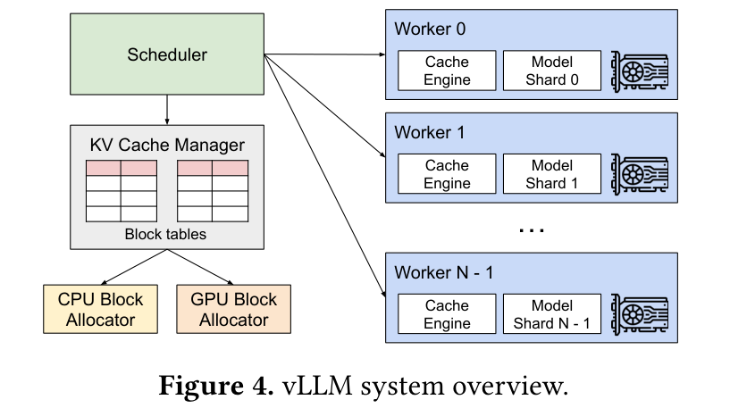

数据路径可以概括为：请求进入队列 → 选择本轮序列 → 分配或共享 KV 块 → 下发输入与块表 → GPU 执行模型 → 更新状态或释放结束序列。

新增的是存储与执行机制，没有新增加的可学习参数，也没有新的训练损失。本文的目标是服务系统效率，不能强行套用“源域、目标域、训练风险最小化”的算法论文模板。

### 3.2 分块注意力：改变读取地址，保留全局注意力语义

原文 §4.1（p.5）定义：

$$
K_j=(k_{(j-1)B+1},\ldots,k_{jB}),\qquad
V_j=(v_{(j-1)B+1},\ldots,v_{jB}).
$$

每块包含固定数量位置的 K、V。逻辑上，第 0、1、2 块仍按 token 顺序组织；物理上，可以分别位于不同地址。

原文 Eq. 4 在当前 PDF 中印为：

$$
A_{ij}=\frac{\exp(q_i^\top K_j/\sqrt d)}{\sum_{t=1}^{\lceil i/B\rceil}\exp(q_i^\top K_t\mathbf{1}/\sqrt d)},\qquad
o_i=\sum_{j=1}^{\lceil i/B\rceil}V_jA_{ij}^\top. \tag{4}
$$

> **原文公式辨析**：已对照 p.5 页面。该版本把分母中的 $\mathbf{1}$ 印在指数内部；若按通常矩阵运算理解，不能得到 Eq. 3 的全局 softmax 分母，疑为排版或书写错误。原文附近将前面的注意力计算引用为“Eq. 4”，也存在编号引用不一致。下面给出与 Eq. 3 一致的解释，不把疑点直接当成正确推导。

设 $S_t$ 是块 $t$ 中当前有效且未被因果掩码排除的位置集合，则语义明确的分母为：

$$
Z_i=\sum_{t=1}^{\lceil i/B\rceil}\ \sum_{r\in S_t}\exp(q_i^\top k_{(t-1)B+r}/\sqrt d).
$$

对每个有效块，用其各位置的指数分数除以同一个 $Z_i$，再对所有块的 V 加权求和，就回到 Eq. 3。这里的 $Z_i,S_t$ 是笔记为解释有效位置所引入的辅助符号。

**直觉**：可以分批取书，但每本书在总评分中的比例仍按同一标准计算。不能对每块分别 softmax 后直接把块结果相加，那会改变不同块之间的相对权重。

因此 PagedAttention 不是稀疏注意力，没有因为分页而跳过远处的历史 token。它仍读取所需历史 KV，主要改变的是地址访问方式。

### 3.3 块池与块表：如何做到按需分配

GPU Worker 先为缓存建立物理块池，管理器跟踪空闲块。每条序列维护自己的逻辑块列表及映射；逻辑相邻的块不要求物理相邻（原文 §4.2，pp.5–6）。

注意两种“预分配”不同：系统可以预先为**整个块池**分配一大段 GPU 内存，但不会为**每个请求**提前占住最大序列长度所需的全部块。

新增 KV 时，先使用尾块空位；尾块填满才申请新物理块。请求完成后释放逻辑引用，引用计数归零的物理块回池。这解决的是 §1.2 中的长期预留与碎片问题。

固定大小块便于回收和再利用，避免不同大小连续区域难以拼接的问题；剩余的主要分配浪费被限制在尾块。这里“最多一个块”描述的是一条顺序追加的逻辑序列，并不意味着多候选请求整体只能浪费一个块。

### 3.4 用 Fig. 6 走完一次生成过程

**下图解释**：左边是逻辑 token 顺序，中间是块表，右边是 GPU 上的物理块。重点跟随映射“逻辑 0 → 物理 7”“逻辑 1 → 物理 1”，再看新逻辑块如何映射到物理 3，而不是按物理块编号顺序读句子（原文 Fig. 6、§4.3，p.6）。

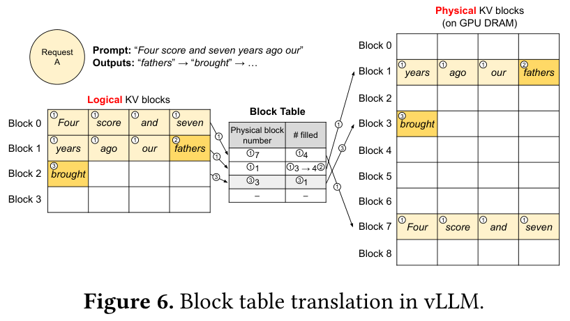

图中为了演示取 $B=4$，prompt 为七个 token：`Four score and seven years ago our`。

1. **Prefill**：申请两个物理块。前四个 token 的 KV 写入物理块 7，后三个写入物理块 1，此时尾块剩一个空位。模型同时给出首个输出 `fathers`。
2. **第一次 Decode**：输入 `fathers`，计算它的 KV 并写入尾块空位，尾块从填入 3 个位置变成 4 个；使用历史状态继续预测 `brought`。
3. **第二次 Decode**：输入 `brought` 时需要保存它的 KV，但原尾块已经满了，因此申请物理块 3，增加“逻辑块 2 → 物理块 3”的映射。
4. **结束与复用**：后续继续同样的追加过程；序列结束后回收不再被其他序列引用的块。

这比“先申请足够放 2048 个位置的空间”更贴合实际生成进度。块表记录的是**KV 在哪里**，不是重新排列句子或改变 token 的语义顺序。

### 3.5 多输出共享：为什么需要 Copy-on-Write

并行采样时，多条输出共享相同 prompt，但后续生成会分叉。共享完整前缀块安全，向共享尾块追加不同 token 的 KV 则需要隔离（原文 §4.4，p.7）。

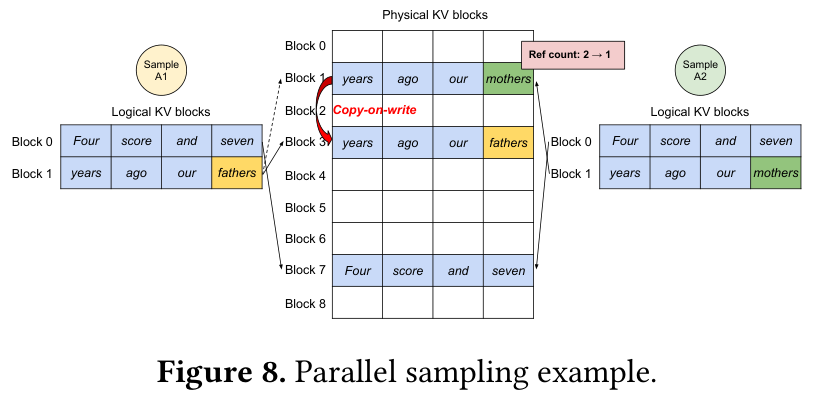

**上图解释**：A1、A2 最初都引用物理块 7 和 1。A1 要写入共享尾块时，将该块复制到物理块 3，并改变自己的映射；A2 留在物理块 1。共同的完整前缀块仍共享，只有发生分叉写入的尾块需要拆开，因而不必复制整条上下文。

引用计数的过程是：共享时增加计数；写共享块且计数大于 1 时申请新块、复制旧内容、更新映射并减少旧计数；当旧块只剩一个引用时，后续写入不再需要复制。

**触发条件是写共享块，而不是每次生成都复制。** 如果前缀恰好填满完整块，后续直接为各分支申请新尾块，就不需要复制已经只读的前缀块。

### 3.6 Beam Search：共享关系会随候选淘汰而改变

并行采样主要共享 prompt；束搜索还会共享已经生成的候选前缀。每轮扩展并选出新的候选时，可能多个新候选都来自同一个旧候选，也可能某个分支全部被淘汰。

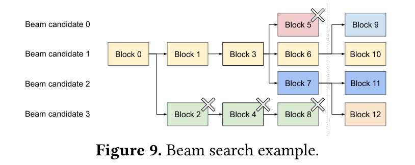

**上图解释**：虚线之前保留四条候选，虚线之后新候选都来自旧候选 1、2。打叉的块 2、4、5、8 已无引用，可释放；保留下来的共同前缀继续共享，再为新分支配置块 9–12。图的重点是“改引用与映射”，从而减少整段 KV 搬运（原文 Fig. 9，p.7）。

`fork`、`append`、`free` 三类高层操作分别对应复制逻辑分支、追加 token、删除序列。它们把多种解码策略的差异转化为块引用关系的变化（原文 §5.2，p.9）。

### 3.7 跨请求共享前缀

如果服务提供者预先指定一段公共任务说明和示例，就可以提前保存它的 KV。新请求的逻辑前缀映射到这组块，只对新增任务输入做必要的 prompt 计算（原文 §4.4，pp.7–8）。

这既节省重复存储，也减少重复前缀计算。但后续 token 仍需关注共享前缀的 KV，因此不是把前缀从上下文中删掉。原文讨论的是预定义共享前缀，不应直接等同于后续版本中所有自动前缀缓存策略。

### 3.8 显存不足：抢占哪个请求，如何恢复

分页减少浪费，却不会创造无限显存。输出增长后块池仍可能耗尽，系统必须配合调度与抢占（原文 §4.5，p.8）。

- **选择请求**：原文采用 FCFS，优先服务更早到达的请求，优先抢占更晚到达的请求。
- **驱逐范围**：一个序列的所有历史 KV 都会被下一轮注意力访问，因此对序列采用全有或全无驱逐。一个请求内共享状态的多个序列作为一组共同抢占、恢复。
- **Swap**：把块交换到 CPU RAM，恢复时传回 GPU；代价主要取决于传输规模、粒度和 CPU–GPU 带宽。
- **Recomputation**：保留 token 序列，恢复时将原 prompt 与已生成 token 作为已知输入，重新计算 KV。它不需要逐个重新采样，因而可用 prompt 阶段的并行计算恢复状态。

原文的交换策略在发生抢占后暂停接收新请求，直到被抢占序列完成，以限制换出空间并保证已有请求推进。这是该论文版本的设计说明，不是对所有 vLLM 版本的永久行为描述。

### 3.9 分布式执行与内核实现

原文采用 Megatron-LM 风格的张量并行。不同 Worker 处理同一组 token，但各自保存相应注意力头的 KV 分片；它们共享块号映射，并不意味着每张卡都保存一份完整 KV（原文 §4.6，pp.8–9）。

每轮先广播输入 token ID 与块表，Worker 本地执行，在需要的层间用 all-reduce 同步中间结果。显存管理决策由中央调度器统一给出，Worker 不需要独立协商块的分配。

内核层优化包括：融合 KV reshape 与写块；融合按块读取与注意力；把多次零散块复制合并到一次 kernel 调用。它们用于减轻间接寻址和小操作的额外成本（原文 §5.1，p.9）。

### 3.10 归一化伪代码与实现成本

**原文没有独立编号的 Algorithm 框。** 以下根据 §4.3–§4.5、§5.2 重述流程，用于理解，不是原文代码或当前 vLLM API。

```text
每一轮迭代：
    根据到达顺序、可用块和序列组状态，选择可执行请求
    若块不足，按策略抢占请求组，交换或保留 token 以便重算
    对每个本轮需要写入 KV 的序列：
        尾块已满 → 申请新物理块，更新块表
        尾块被共享且需要写入 → 复制该块，更新映射与引用计数
    将本轮输入 token 和块表发送给 GPU Worker
    Worker 写入新增 KV，并通过块表读取历史 KV 计算注意力
    采样输出，更新候选序列与停止状态
    删除结束或淘汰序列的逻辑引用，回收引用计数为 0 的物理块
```

我的复杂度理解：对长度为 $L$ 的单序列，块表规模随 $\lceil L/B\rceil$ 增长；一个解码查询仍要读取历史 KV，分页本身不减少标准注意力所需的历史位置数。额外成本来自块表访问、分支、尾块处理、写时复制，以及压力下的交换或重算。

## 四、实验结果

### 4.1 实验设置：比较对象与工作负载

模型包括 OPT-13B、OPT-66B、OPT-175B，以及共享前缀实验中的 LLaMA-13B。硬件是 Google Cloud A2 实例上的 NVIDIA A100（原文 §6.1，p.10）。

以下是为比较“KV 容量余量”整理的 **Table 1 列子集**，未另贴原表，避免重复：

| Table 1 模型列 | GPUs 行 | Memory for KV cache 行 | Max. # KV cache slots 行 |
| --- | --- | --- | --- |
| 13B | 1 × A100 40GB | 12 GB | 15.7K |
| 66B | 4 × A100 40GB | 21 GB | 9.7K |
| 175B | 8 × A100-80GB | 264 GB | 60.1K |

出处为原文 Table 1（p.9）。这些是模型与服务器配置，**不是吞吐量主结果**。该论文的主性能结果主要通过图展示，不能编造不存在的“主结果表”。表中也说明，大模型配置不一定更缺 KV 空间，必须看分配给它的硬件总量。

工作负载使用真实文本的长度分布来合成请求。ShareGPT 平均输入/输出长度分别为 161.31/337.99 token，Alpaca 为 19.31/58.45 token（原文 Fig. 11，p.9）。前者更长、变化更大，后者偏短。

由于数据集没有到达时间，作者合成泊松到达流量。大多数实验使用 1 小时轨迹，OPT-175B 因成本限制用 15 分钟轨迹。因此结果是指定模型、硬件和合成到达条件下的服务能力，不能直接当作真实生产流量的保证。

FasterTransformer 配上作者实现的动态 batching 调度器。Orca 因当时无公开实现，由作者自行实现，并假定使用 buddy allocator。其三个变体含义如下：

- **Orca (Max)**：按模型最大长度预留空间。
- **Orca (Pow2)**：按真实输出长度对应的 2 的幂上取整预留，属于论文的评估假设，不是对现实预测精度的测量。
- **Orca (Oracle)**：预知真实输出长度，是理想化分配基线；即便如此，仍存在提前保留和连续分配问题。

### 4.2 先看懂指标，才能解释“吞吐提升”

论文主要测量 **normalized latency**，即先把每条请求的端到端延迟除以其输出 token 数，再在请求之间取平均。用辅助符号可写为：

$$
\overline{\ell}=\frac{1}{N}\sum_{r=1}^{N}\frac{T_r^{\mathrm{end-to-end}}}{n_r^{\mathrm{output}}}.
$$

这是对原文 §6.1 文字定义的数学化表达，不是原文编号公式。它包含端到端服务时间的影响，**不等于相邻输出 token 的时间间隔 TBT，也不是 P99 延迟指标**。

结果图横轴为请求到达率，纵轴为归一化延迟。同一延迟水平下，曲线能延伸到更右侧，表示系统可承受更高的请求速率；一旦到达率超过服务能力，排队会持续积累，曲线就会快速上升。

### 4.3 基础采样：内存受限时，vLLM 的容量优势更明显

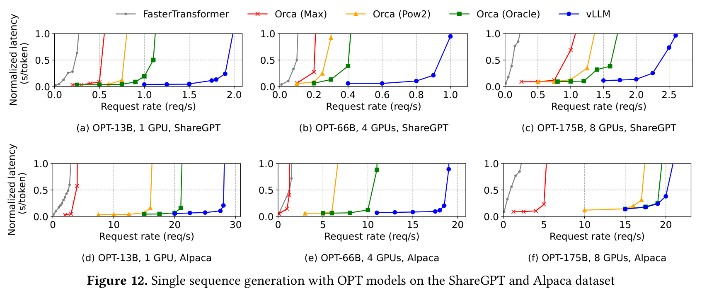

**上图解释**：上排是较长的 ShareGPT，下排是较短的 Alpaca，三列对应不同模型规模。蓝色 vLLM 曲线通常更靠右；右下角则出现优势缩小的情形。阅读时应比较同一子图内相似延迟下的横轴位置，而不是跨图直接比较曲线高度（原文 Fig. 12，p.10）。

原文 §6.2（p.11）报告，ShareGPT 上 vLLM 在相近延迟下支持的请求速率为 Orca (Oracle) 的 **1.7–2.7 倍**、Orca (Max) 的 **2.7–8 倍**。相对 FasterTransformer 的最大提升可达 **22 倍**，但后者同时存在粗粒度调度差异，不能把全部倍数归因于分页本身。

摘要的“2–4 倍”是总体概括，不是每个配置都严格位于该范围。做组会汇报时，应给具体基线、工作负载和指标，避免只说“加速四倍”。

为什么 Fig. 12(f) 优势缩小？OPT-175B 的服务器提供较大的 KV 容量，而 Alpaca 序列短；连续分配基线也能容纳足够大的批次，主要约束转向计算能力。此时继续提高内存利用率，未必带来同比例的吞吐收益。

### 4.4 中间证据：省下显存之后，批次确实变大了吗

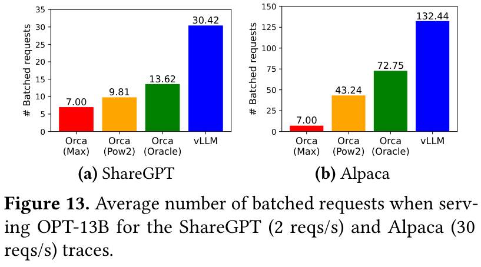

**上图解释**：在 OPT-13B、ShareGPT 的指定负载下，Orca (Oracle) 平均同时批处理 13.62 个请求，vLLM 为 30.42 个；Alpaca 对应为 72.75 与 132.44。纵轴是平均批处理请求数，允许小数，并不是 requests/s。它把 Fig. 2 的内存效率与 Fig. 12 的服务容量连接起来（原文 Fig. 13，p.10）。

从这些观察可以得到机制一致的证据链：更少无效占用 → 更多请求状态驻留 → 更大有效批次 → 服务曲线右移。但这是整套系统的实验，仍应注意调度、内核和内存管理之间的共同作用。

### 4.5 复杂解码：共享越多，为什么收益越大

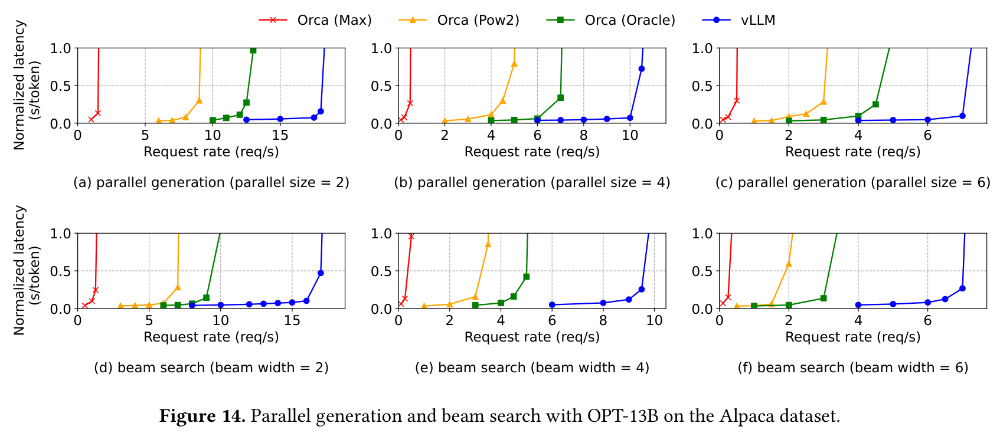

**上图解释**：上排是并行采样，下排是束搜索，从左到右增加候选数或束宽。vLLM 在可共享前缀更多的束搜索中受益更大；不同列每个请求的工作量不同，不能把横轴数值直接当作同一输出成本下的比较（原文 Fig. 14，p.11）。

原文 §6.3 说明，在 OPT-13B、Alpaca 上，相对 Orca (Oracle)，基础采样约为 **1.3 倍**，束宽为 6 时约为 **2.3 倍**。这是该组条件下的对比，不应写成任意束搜索配置都有相同收益。

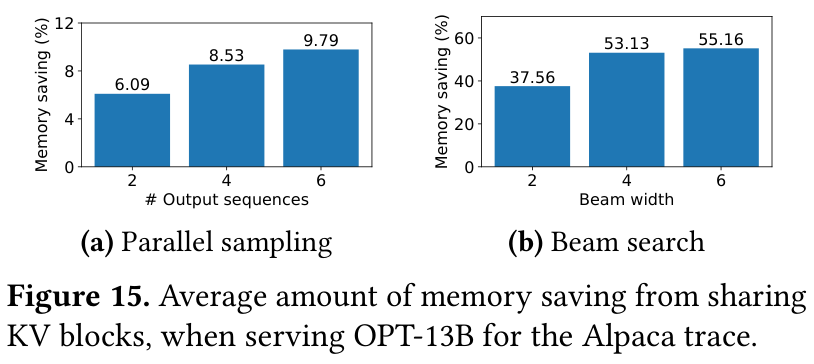

**上图解释**：纵轴是“共享省下的块数 / 不共享时总块数”，不是总 GPU 显存节省率。在 Alpaca 上，并行采样从 2 到 6 个输出时节省 6.09%–9.79%，束搜索相应为 37.56%–55.16%。束搜索还能共享生成过程中的前缀，因此空间收益更大（原文 Fig. 15，p.11）。

正文还报告 ShareGPT 上的对应范围分别为 16.2%–30.5% 与 44.3%–66.3%。因此常见概括“最高节省 55%”只覆盖图中的 Alpaca 实验，并非全文所有工作负载的最高值。

### 4.6 共享前缀与聊天场景：不要混淆两类收益

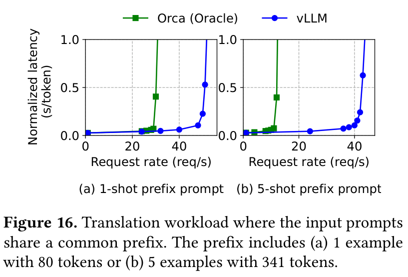

**上图解释**：两图分别共享一个示例与五个示例的前缀，长度为 80 和 341 token。这里用 LLaMA-13B 和 WMT16 英德翻译任务，报告相对 Orca (Oracle) 的吞吐收益分别为 1.67 倍和 3.58 倍；较长公共前缀提供更多可避免的重复计算与存储（原文 Fig. 16、§6.4，p.12）。

原文 Fig. 10 用英法翻译举例解释共享前缀机制，实际 Fig. 16 实验是英德翻译，两者不能混写成同一个实验设置。

聊天实验使用 OPT-13B 和 ShareGPT，将历史拼接成 prompt，截取最后 1024 个输入 token，并最多输出 1024 token。vLLM 支持约为三个 Orca 变体 **2 倍**的请求速率（原文 Fig. 17、§6.5，p.12）。

**该聊天实验没有在不同对话轮次之间保留 KV Cache。** 所以此处性能提升不能解释为“跨轮聊天缓存复用”，主要仍来自长 prompt 下更有效的内存管理。

### 4.7 消融：为什么算子更慢，端到端却更快

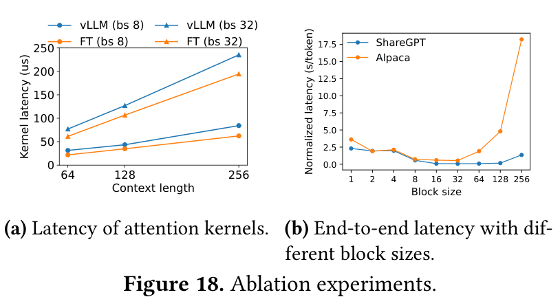

**上图解释**：左图固定批次和上下文长度比较 attention kernel 延迟，vLLM 曲线更高；右图改变块大小测端到端延迟，过小或过大都可能变差。两图共同说明，最优内存管理需要在硬件访问效率和空间浪费之间折中（原文 Fig. 18，p.12）。

原文 §7.1 报告 PagedAttention 相对 FasterTransformer 的注意力内核延迟增加 **20%–26%**，原因包括块表访问、额外分支和可变序列长度处理。这是注意力算子的开销，不能推成整个模型端到端慢同样比例。

§7.2 中，ShareGPT 在块大小 **16–128** 时效果较好，Alpaca 在 **16、32** 时较好。短序列如果使用过大的块，会留下更多空位，也降低共享粒度；块太小则不利于 GPU 并行读取和处理。

论文因此采用默认 **16 token/块**。这个值是文中软硬件与负载下的经验折中，不是数学证明的全局最优值，更不是 16 字节或 16 个请求。

### 4.8 Swap 与 Recomputation：恢复机制取决于传输粒度

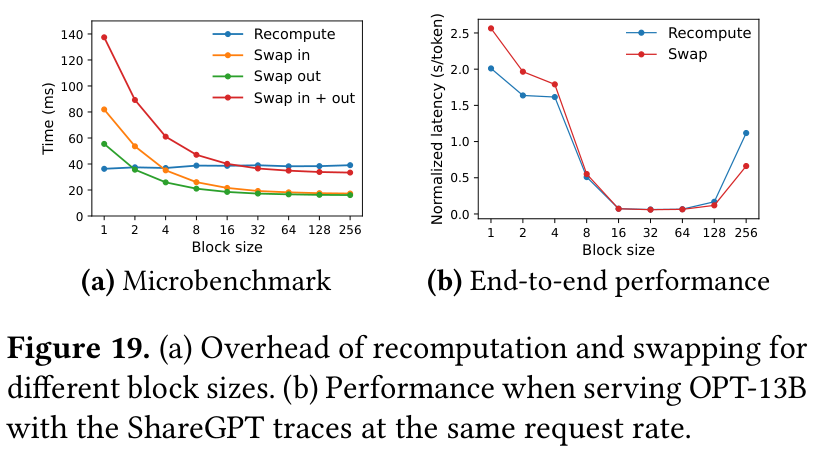

**上图解释**：左侧把恢复成本拆成重算、换入、换出及换入加换出；右侧观察同一请求速率下的端到端表现。小块带来大量小传输，降低有效 PCIe 带宽，而重算不依赖缓存块的传输粒度（原文 Fig. 19，p.13）。

原文 §7.3 的可靠趋势是：小块时重算更有利，大块时交换更有利；块大小 **16–64** 的端到端表现接近。实际选择还取决于 GPU 算力、PCIe 带宽与上下文长度。

> **措辞核对**：§7.3 关于“20%”的英文句子表述不清晰，若机械直译，会与“大块时 swapping 更高效”及图示产生冲突。因此本笔记不把该句转述为精确的普遍性能界限，也不从曲线估读未标注的小数。

## 五、与相关工作的区别

### 5.1 Orca：调度粒度与存储粒度相互补充

**Orca** 的迭代级调度使一个批次中的已完成请求及时退出、新请求及时进入，减少等待整个批次完成的浪费。**PagedAttention** 解决请求加入后 KV 应怎样分配，让更多请求的工作集能装进显存（原文 §9，p.13）。

所以连续批处理与分页缓存是互补的。即使调度器很灵活，空间分配低效仍限制并发；反过来，只节省空间却不会及时补入新请求，也未必充分利用这部分收益。

### 5.2 FasterTransformer：局部算子速度与整体服务效率不同

**FasterTransformer** 侧重优化执行内核和推理延迟。本文在它的 attention kernel 基础上适配分页访问，但端到端结果还涉及作者附加的调度器与内存分配方式（原文 §5.1、§6.1）。

因此比较时应分别回答“同样工作量的单次算子有多快”和“持续到达请求时系统能服务多少用户”，不能用其中一个指标替代另一个。

### 5.3 FlashAttention：算子内部 I/O 与请求状态管理的区别

**FlashAttention** 使用分块与内核优化减少注意力计算中的 I/O 和中间存储；**PagedAttention** 让持久 KV 状态支持不连续分配及共享（原文 §9，p.14）。

两者都出现 block/tiling，并不代表同一种优化。本文 §4.3 还指出 prompt 阶段可以使用传统自注意力算法，例如 FlashAttention；分页机制主要解决跨迭代保存和读取 KV 的布局问题。

### 5.4 FlexGen：目标负载不同

**FlexGen** 研究有限 GPU 显存下权重和 token 状态的交换，原文指出其目标不是本文的在线服务场景（原文 §9，pp.13–14）。离线吞吐导向可以接受的等待和交换代价，未必适合持续到达的在线请求。

## 六、核心贡献总结

1. **把瓶颈定位到动态请求状态的分配效率。** 通过空间构成图与实际批次规模，解释连续预留如何限制并发，而不只停留在“显存不够”的现象描述。
2. **让注意力计算支持分页 KV。** 逻辑与物理位置解耦，模型语义与参数保持不变，应用层内核能够按映射读取缓存。
3. **用统一的块管理支持复杂解码。** 引用计数、写时复制、分支与释放，让并行采样、束搜索和公共前缀共享都能落到同一套机制上。
4. **完成端到端系统并解释收益来源。** 实验连接了内存利用率、批次规模、服务容量，同时展示了内核开销和算力受限时的边界。

真正值得借鉴的是整条系统设计链：**改变数据布局，使更合理的分配成为可能，再用调度与内核把空间收益转成服务能力。**

## 七、讨论与局限

**PDF 中无 Limitations 章节**，但有独立的 §8 Discussion（p.13）。下面明确区分作者讨论与我的分析。

### 7.1 作者明确讨论的适用条件

- 方法适合状态动态增长、长度事先未知、性能受 GPU 显存容量限制的负载。
- 常规 DNN 训练的张量形状通常更可预测，内存分配可以提前规划，未必需要相同机制。
- 对主要受算力限制的负载，提高空间效率未必提高速度；间接寻址和非连续访问反而可能引入额外成本。
- 本文不是直接照搬操作系统分页。全序列驱逐利用了注意力访问全部历史状态的特性，重算则利用了 KV 可以从 token 序列重新生成的特性。

### 7.2 从实验设计得出的边界判断

以下是我的阅读分析，不是作者给出的全部局限清单：

- **评价指标边界**：平均归一化端到端延迟无法单独说明输出是否流畅，也无法替代首 token 延迟、TBT 或尾延迟。这为继续研究调度与吞吐—延迟权衡留下空间。
- **基线边界**：Orca 为作者重实现版本，结果依赖文中分配器和长度预留假设，不能无条件外推到所有连续分配系统。
- **负载边界**：长度分布来自数据集，到达时间则是合成的，尚不能覆盖所有突发流量、业务混合和生产 SLO。
- **内存优化边界**：PagedAttention 不压缩每个 KV 向量，也不减少模型参数；上下文继续变长时，绝对 KV 需求仍会增加。
- **精度边界**：作者强调不改变模型准确性，方法也保留完整注意力语义；但不能由此推断不同 CUDA 实现逐 bit 一致，或声称文中包含不存在的详细精度对照表。

## 八、对后续学习与复现的启发

### 8.1 如何检验自己是否理解了论文

能够独立解释下面四个问题，就抓住了主要内容：

1. **为什么知道最终长度仍会浪费？** 因为未来空间被提前占住，而且仍受连续分配约束。
2. **为什么可以把块放散？** 因为注意力依靠块表读取正确 K、V，位置与全局归一化语义没有变。
3. **为什么只复制尾块？** 已完成的共享前缀保持只读，分支追加只会写到尚未填满的尾块或新块。
4. **为什么单次 attention 稍慢，服务能力还能提高？** 因为减少空间浪费后能容纳更多请求，端到端收益可以超过局部算子的额外成本。

### 8.2 一个可执行的小规模复现实验

以下是我的实验建议，不是论文已经报告的结果。首先固定模型、精度、硬件、输入输出长度和调度策略，避免把多个变量同时改变。

- 对比按最大长度连续预留、按已知长度预留、分页按需分配，测量有效 KV、空槽、实际批次与完成请求数。
- 分别采用短序列和长序列负载，检查容量余量变化是否能解释吞吐差异。
- 在同一分页实现中打开或关闭共享，改变并行输出数与束宽，检验收益是否随共享机会增长。
- 扫描块大小，同时记录内核时间、总延迟、块数、复制量和空槽量，观察空间效率与访存效率的折中。
- 除论文指标外增加 TTFT、TBT 和 P99，并明确这些是补充指标，不能与原文归一化延迟混用。

如果使用当前版本 vLLM，应记录具体版本与默认优化，并说明它和论文版本可能不同。否则复现到的收益无法准确归因于 PagedAttention 的原始设计。

### 8.3 组会口述摘要

这篇论文研究的核心问题是，大模型服务要提高吞吐，需要同时处理更多请求，但每条请求的 KV Cache 会持续增长。过去的连续预留方式又留下了很多当前用不上的空间，导致显存看起来满了，实际保存有效状态的比例却不高。

作者的办法是把 KV 切成固定大小的小块，用块表记录每块放在哪里，需要时再申请。多条输出如果有共同前缀，就先共享这些块；真正要写入分叉内容时，再复制需要修改的尾块。

实验的关键不只是吞吐曲线变好了，而是证明省下的显存确实让批次变大了。另一方面，分页 attention 本身还有访问块表的成本，所以它不是所有场景都更快。当显存已经足够、瓶颈转向计算时，优势就会减小。这篇论文给我的主要启发是，数据怎么存、状态怎么共享，会直接影响系统能服务多少请求。
